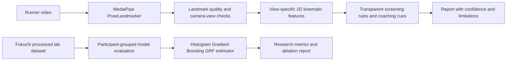

# SportsAI+ / Stridewise v2.0
### AI-Powered Athletic Performance Analysis · RNSIT Final Year AIML Project

---

## Project Structure and Intended Architecture

```
sportsai_v3/
├── frontend/          React + TypeScript + Vite + MediaPipe (browser)
├── backend/           FastAPI + Python AI pipeline
├── ai/                Biomechanics rules, coaching templates, and legacy experiments
└── storage/           Runtime data (auto-created, gitignored)
```

---

## Quick Start

### Frontend
```bash
cd frontend
npm install
npm run dev:all               # browser app + local persistence API
# Open http://localhost:5173
```

For PowerShell, copy `.env.example` to `.env.local` only when configuring Supabase; the app works without it. `npm run dev` starts only Vite, so saved dashboard history uses offline data unless the local Node API is also running. To run the local persistence API separately, use `node server.mjs` in another terminal.

### Python video backend (optional, experimental)
```bash
pip install -r backend/requirements.txt
cd backend
uvicorn app.main:app --reload --port 8000
```

Python video processing is disabled in the browser unless `VITE_BACKEND_URL` is explicitly set. Enabling it uploads the selected clip to the configured backend. The main browser screen does not depend on this legacy experimental pipeline.

### Supabase (optional — for cloud sync)
1. Create project at supabase.com
2. Run `frontend/supabase_schema.sql` in SQL Editor
3. Add keys to `frontend/.env.local`

---

## What Works Without the Backend

The **frontend** runs completely standalone:
- Real MediaPipe pose detection (browser, @mediapipe/tasks-vision)
- 2D landmark-based running-form screening and foot-contact heuristics
- Rule-based coach feedback with voice playback
- Action plan with drill prescriptions
- Country-specific nutrition guidance from bundled content
- Local nutrition Q&A that retrieves country-specific passages and displays each source file
- Supabase auth + cloud sync (if configured)
- Demo mode with sample data

### Runtime architecture



These are **two separate inference paths**. The browser video screen uses MediaPipe's pretrained 2D pose model and descriptive geometry/rules. The offline GRF research model uses processed, motion-capture-derived joint angles and measured force-plate targets. It is not callable from the video screen because the public dataset does not pair ordinary phone video with those lab angle definitions. The interface must not show its laboratory GRF prediction as a video measurement.

## Current Research ML Model

The reproducible offline research module is in [`research/`](research/README.md). It downloads the processed tables for 39 runners from a CC BY 4.0 public running-biomechanics dataset, then trains and evaluates a model to estimate the dataset's vertical ground-reaction force from laboratory-derived lower-limb joint angles. Validation holds out whole participants with grouped cross-validation.

The current locked evaluation reserves eight participants before model selection. Participant-balanced Histogram Gradient Boosting was chosen by four-fold subject-grouped validation on the other 31, then scored once on the held-out cohort: **R² 0.958, MAE 1.263 N/kg, RMSE 1.732 N/kg** across 1,668 samples. The kinematic Ridge baseline scored R² 0.903 and MAE 2.071 N/kg. A paired test comparison found participant weighting made no clear difference versus unweighted HGB; a predeclared feature ablation found that a 12-input center-point model had similar error to the 48-input full model. These results use processed lab motion-capture data, not phone video, MediaPipe landmarks, injury outcomes, or clinical measurements. They do not validate the estimator for the frontend. See [`research/RESULTS.md`](research/RESULTS.md) and the machine-readable [locked evaluation](storage/results/grf_model/holdout_evaluation.json).

## Existing Optional Backend Prototype

The FastAPI upload/report path is separate from this research model. Its legacy MotionBERT-shaped network is trained on synthetic skeletons, its ST-GCN wrapper is a peak-finding heuristic rather than a graph-convolution network, D-S fusion receives duplicated evidence, and its RAG response is template-generated. These components are experimental and must not be presented as validated ML or force-plate measurements. The backend also uploads the video when enabled; the browser-only path keeps video processing local.

---

## Environment Variables

```bash
# frontend/.env.local
VITE_SUPABASE_URL=https://YOUR_PROJECT.supabase.co
VITE_SUPABASE_ANON=YOUR_ANON_KEY
# Optional: setting this enables uploading videos to the Python backend.
# Leave unset for browser-only analysis.
# VITE_BACKEND_URL=http://localhost:8000
```

```bash
# backend (set as env vars)
FRONTEND_ORIGIN=http://localhost:5173    # CORS origin
```

---

## Honest Assessment of AI Components

| Component | What it actually is |
|---|---|
| MediaPipe PoseLandmarker | Real pretrained ML — Google BlazePose |
| Research GRF estimator | Histogram Gradient Boosting trained on public processed biomechanics data; laboratory kinematic inputs only; participant-held-out evaluation |
| Legacy “MotionBERT” transformer | Synthetic-data toy model; not a validated 3D pose lifter |
| Legacy D-S fusion | D-S-like confidence math, but current pipeline duplicates its input evidence |
| Legacy “ST-GCN” | Ankle trajectory peak heuristic, not a graph-convolution model |
| Frontend running analysis | 2D geometry/statistics and heuristics on landmark positions |
| MKI Score | Weighted composite formula — not ML |
| Coach Engine | Rule-based if/else |
| RAG Engine | TF-IDF retrieval runs, but recommendations are template-generated |
| Nutrition Q&A | Browser-side lexical retrieval over shared country guides; returns source passages, not free-form LLM answers |
| Browser foot-strike screen | Landmark-based contact heuristic; not force-plate ground truth |
| Backend stride length / contact time | Heuristic estimates, not calibrated measurements |

---

## Project Contribution and Limitations

1. A reproducible participant-held-out benchmark for vertical GRF estimation from gait-cycle kinematic signals.
2. A participant-balanced training comparison and joint/temporal-context ablation showing that fewer kinematic inputs can retain similar error on this dataset; the small held-out cohort and absent external validation limit the claim.
3. A working browser-side running screen as a separate, non-clinical product prototype.

The public dataset has no ordinary phone video, so it cannot establish image-to-GRF performance. A valid end-to-end video model needs a suitable paired dataset or a new synchronized video/motion-capture study with appropriate ethics approval.

---

## Data and Privacy Notes

- CORS restricted to configured frontend origin (not `*`)
- Upload IDs used — filesystem paths never exposed to clients
- File size limit: 500 MB
- Input validation: extension, MIME type, minimum resolution, duration
- The browser-only experience analyzes video locally. When the optional backend is enabled, the selected video is uploaded for server-side processing.
- The public dataset is downloaded to `storage/datasets/` and verified against publisher-provided MD5 checksums; cite the source and follow its CC BY 4.0 attribution terms.

*SportsAI+ · RNSIT · AIML Department · 2026*
